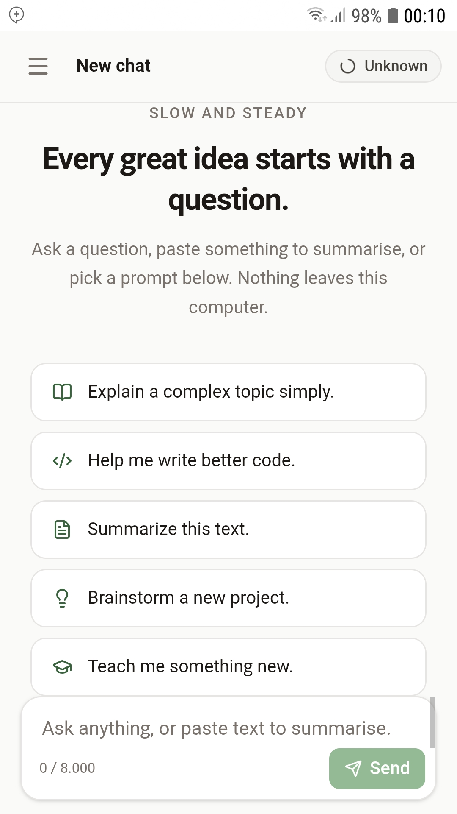
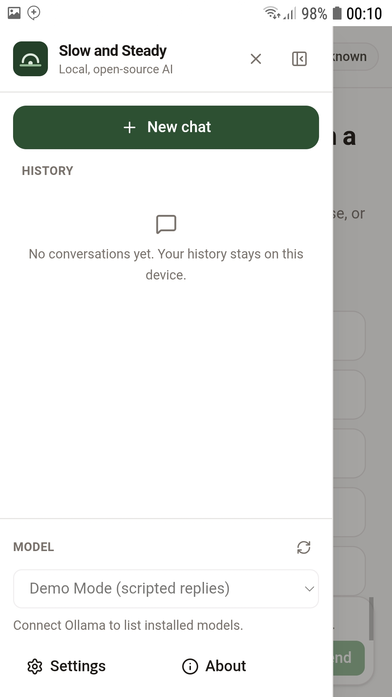
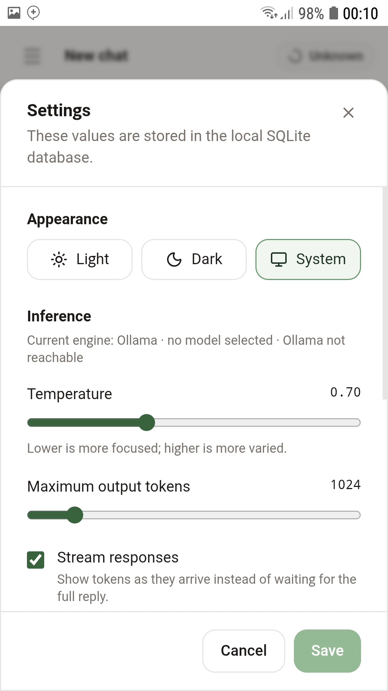

# Slow and Steady

**Build Something with Open-Source AI at Its Core.**

A private chat app for your own computer. It talks to open-source models through [Ollama](https://ollama.com). Your conversations stay in a local SQLite file — no account, no cloud AI, no telemetry.

You can try the whole interface in **Demo Mode** without installing a model.

Hacktoberfest Week 3 write-up: [SUBMISSION.md](./SUBMISSION.md)

<p align="center">
  
  
  
</p>

<p align="center"><sub>Chat · Menu · Settings</sub></p>

---

## What you need

- Node.js 20+ and npm
- Python 3.12+
- Ollama (only if you want real model replies)

---

## Run it

**1. Backend**

Linux / macOS:

```bash
cd backend
python3 -m venv .venv
source .venv/bin/activate
pip install -r requirements.txt
```

Windows (PowerShell):

```powershell
cd backend
python -m venv .venv
.\.venv\Scripts\Activate.ps1
pip install -r requirements.txt
```

If `venv` is missing, [`uv`](https://docs.astral.sh/uv/) works:

```bash
cd backend
uv venv .venv
uv pip install --python .venv/bin/python -r requirements.txt
```

**2. Frontend**

```bash
cd frontend
npm install
```

**3. Start both processes**

Linux / macOS — two terminals:

```bash
./scripts/start-backend.sh
./scripts/start-frontend.sh
```

Windows:

```powershell
.\scripts\start-backend.ps1
.\scripts\start-frontend.ps1
```

Open **http://127.0.0.1:4747**. Choose **Start Demo** or **Connect Local AI**.

| Piece | Address |
| --- | --- |
| App | http://127.0.0.1:4747 |
| API | http://127.0.0.1:8747 |
| Ollama (optional) | http://127.0.0.1:11434 |

---

## Demo Mode

No model required. Replies are scripted and clearly labelled that way.

Use it to click around: chat, history, rename, settings. Demo Mode never silently covers for a failed local model.

---

## Local AI (Ollama)

The app never downloads a model for you.

```bash
# install from https://ollama.com, then:
ollama pull qwen2.5:1.5b
```

Pick that model (or any name from `ollama list`) in the sidebar.

**Local AI Ready** appears only after the app checks that Ollama is running *and* the selected model is installed.

---

## Tests

Ollama is mocked. You do not need a downloaded model.

```bash
# backend
cd backend
.venv/bin/python -m pytest -q

# frontend
cd frontend
npm test
```

Last run here: backend **46 passed**, frontend **17 passed**.

---

## Privacy

- Chats live in `backend/data/` on this machine (gitignored).
- The API binds to localhost.
- After install, chat traffic is only UI → local API → (optional) local Ollama.

Network is used for `npm install` / `pip install`, and for `ollama pull` if you want a model. Chat itself does not call a cloud LLM.

---

## Layout

```
frontend/    React + Vite + Tailwind
backend/     FastAPI + SQLite + Demo/Ollama providers
scripts/     start helpers
docs/        screenshots
```

---

## If something breaks

| You see | Try |
| --- | --- |
| Backend Unavailable | Start the API. `curl http://127.0.0.1:8747/api/health` |
| Ollama Offline | Start Ollama (`ollama serve` or the app) |
| No Models Installed | `ollama pull qwen2.5:1.5b` |
| Model Not Found | `ollama list` and pick a name that is there |

More detail lives in [SUBMISSION.md](./SUBMISSION.md).
